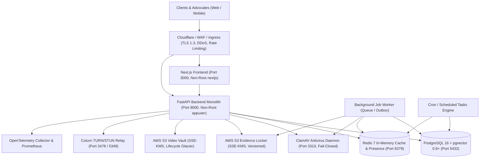

# Legal Case Companion (LCC) — Production Deployment Architecture

**Document ID:** `LCC-ARCH-DEPLOY-2026-01`  
**Classification:** Internal Technical Architecture  
**Target Environment:** Staging & Production (Hybrid Containerized / Managed Cloud)  
**Region:** `ap-south-1` (Mumbai, India)  

---

## 1. System Overview & Architectural Topology

The Legal Case Companion is an India-focused legal technology platform comprising a FastAPI modular monolith, a Next.js 16 web application, a legal vector search engine (pgvector), WebRTC consultation relays, an Evidence Locker, and background workers.



---

## 2. Service Tier Specifications

### 2.1 Web Application Tier (Frontend)
- **Framework:** Next.js 16 / React 19 (Server-Side Rendering & Static Optimization).
- **Runtime:** Node.js 20 Alpine Linux in multi-stage Docker container.
- **Process User:** Non-root system user `nextjs` (UID 1001, GID 1001).
- **Port:** `3000`.
- **Healthcheck Probe:** `wget --spider http://localhost:3000/`.
- **Networking:** Ingress restricted to Cloudflare WAF; talks to backend over private container network (`http://backend:8000`).

### 2.2 Application Service Tier (Backend Monolith)
- **Framework:** FastAPI 0.115+ / Starlette / Pydantic v2 / SQLAlchemy 2.0.
- **ASGI Server:** Uvicorn with standard event loop (`uvloop`), multi-worker Gunicorn in production.
- **Runtime:** Python 3.11-slim multi-stage container without build compilers in runner.
- **Process User:** Non-root system user `appuser` (UID 10001, GID 10001).
- **Port:** `8000`.
- **Probes:**
  - Liveness: `GET /api/v1/health/live` (process health only, no external dependencies).
  - Readiness: `GET /api/v1/health/ready` (validates PostgreSQL connectivity).
  - Operator Details: `GET /api/v1/health/details` (Postgres, Redis, Storage, ClamAV, Queues).
  - Prometheus Scraping: `GET /metrics` (OpenMetrics format).

### 2.3 Background Processing Tier (Worker & Scheduler)
- **Worker Process:** `python -m app.worker`.
- **Scheduler Process:** `python -m app.scheduler`.
- **Concurrency Model:** Thread-pool and async workers consuming database-backed transactional outbox queues (`outbox_events`) and background jobs (`background_jobs`).
- **Distributed Locking:** Redis-backed distributed locks (`app/core/locking.py`) preventing duplicate job executions across auto-scaled container instances.

### 2.4 Data Tier (PostgreSQL + pgvector)
- **Engine:** PostgreSQL 16.x or 18.x with native `pgvector >= 0.8.0`.
- **Container Image:** `pgvector/pgvector:pg16`.
- **Connection Driver:** `psycopg` (v3 binary) with connection pooling (`QueuePool`).
- **Vector Search:** HNSW indexing (`vector_cosine_ops`, `m=16`, `ef_construction=64`) on 1536-dimensional embeddings.
- **Primary Keys:** Relational entities enforce cryptographically sorted UUIDv7 keys.
- **WAL Archival:** Continuous WAL replication to S3 for Point-in-Time Recovery (PITR).

### 2.5 In-Memory & Real-Time Presence Tier (Redis)
- **Engine:** Redis 7.x Alpine.
- **Role:** Session caching, real-time consultation room presence, instant-call ringing states, rate limiting counters (`slowapi`), and distributed locks.
- **Graceful Degradation:** In local dev or degraded network modes, backend falls back gracefully to in-process memory caches.

### 2.6 Security & Malware Inspection Tier (ClamAV)
- **Engine:** ClamAV 1.4.x daemon (`clamav/clamav:1.4.1`).
- **Communication:** TCP socket over port `3310`.
- **Signatures:** Automated `freshclam` updates every 2 hours from official mirrors.
- **Fail-Closed Policy:** If ClamAV is offline in staging/production, file uploads fail closed (remain quarantined in Evidence Locker until certified).

---

## 3. Render Deployment Topology (`render.yaml`)

The platform supports automated cloud deployment via [`render.yaml`](file:///home/ashish/Desktop/lcc/render.yaml):

```yaml
services:
  # 1. API Web Service
  - type: web
    name: lcc-backend
    env: docker
    region: singapore # or AWS ap-south-1
    plan: starter
    healthCheckPath: /api/v1/health/live
    preDeployCommand: "alembic upgrade head" # Safe database migration hook

  # 2. Background Job Worker
  - type: worker
    name: lcc-worker
    env: docker
    dockerCommand: "python -m app.worker"

  # 3. Scheduled Cron Tasks
  - type: worker
    name: lcc-scheduler
    env: docker
    dockerCommand: "python -m app.scheduler"

  # 4. Next.js Web Frontend
  - type: web
    name: lcc-frontend
    env: docker
    dockerfilePath: ./frontend/Dockerfile
    dockerContext: ./frontend
    healthCheckPath: /
```

---

## 4. Zero-Downtime Rolling Update & Migration Sequencing

To prevent schema conflicts and API interruptions during deployment, LCC enforces a strict four-phase deployment sequence:

```
Step 1: Code Review & CI Pass
   │ (All 915 tests, Mypy, Ruff, Trivy, Secret Scanners green)
   ▼
Step 2: Database Migration (Pre-Deploy Hook)
   │ Execute: alembic upgrade head
   │ (Schema changes MUST follow Expand-and-Contract: new columns nullable)
   ▼
Step 3: Rolling Container Updates
   │ Launch new backend containers running version N+1
   │ Readiness probes (/api/v1/health/ready) verify connectivity
   │ Traffic shifts progressively from N to N+1
   ▼
Step 4: Deprecate Old Containers
   │ Graceful termination (SIGTERM, 30s drain timeout)
   │ Workers complete active in-flight jobs before exit
```

---

## 5. Security & Network Boundary Controls

1. **Ingress & TLS Enforcement:**
   - Strict TLS 1.3 encryption across all public interfaces.
   - HTTP Strict Transport Security (HSTS) with 1-year max-age and preload.
2. **CORS Governance:**
   - Strict whitelist matching `FRONTEND_URL` (`https://app.legalcasecompanion.in`).
   - Wildcard (`*`) origins are strictly prohibited and blocked at boot.
3. **Internal Network Isolation:**
   - Database, Redis, and ClamAV ports are unmapped from the host; accessible strictly via internal container networks (`lcc_internal`).
4. **Data Sovereignty (DPDP Act):**
   - Cloud resources, S3 buckets, and PostgreSQL instances reside strictly in AWS `ap-south-1` (Mumbai).
