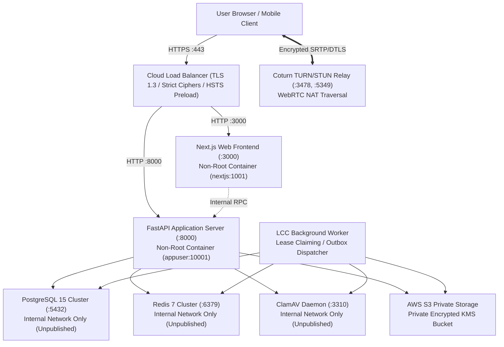

# Legal Case Companion — Production Deployment Runbook

**Document Reference**: LCC-DOC-024  
**Classification**: High-Security Operational Standard  
**Revision**: 1.0.0 (`prod-2026.09.04`)  
**Target Topology**: Cloud Load Balancer (HTTPS / TLS 1.3 Termination) $\to$ Next.js Web Frontend (Port 3000) + FastAPI Core API (Port 8000) $\to$ PostgreSQL 15 + Redis 7 + AWS S3 + ClamAV Daemon + Background Workers

---

## 1. Pre-Deployment Readiness Checklist

Before initiating any deployment to staging or production, the Release Engineer must verify:

| Gate # | Check Description | Verification Command / Artifact | Required State |
| :--- | :--- | :--- | :--- |
| **G-1** | CI Pipeline Status | GitHub Actions Pipeline | `100% Passing` on target release commit |
| **G-2** | Migration Linear Head | `alembic heads` | Single linear head (no branches) |
| **G-3** | Production Config Audit | `python scripts/verify_production_config.py --env production` | Exit Code 0 (0 Critical, 0 Blocking) |
| **G-4** | SBOM Manifests | `python scripts/generate_sbom.py` | `sbom-backend.json` & `sbom-frontend.json` generated |
| **G-5** | Container Image Audit | `docker-compose -f docker-compose.prod.yml config` | Image tags pinned; internal ports unexposed |
| **G-6** | Database Backup | `pg_dump -Fc legal_db > backup_predeploy.dump` | Complete snapshot stored in private backup bucket |

---

## 2. Production Topology & Network Security Boundary



### Critical Network Rules
1. **Unpublished Internal Services**: `postgres`, `redis`, `clamav`, and `worker` MUST NOT bind to `0.0.0.0` or expose host ports. They exist strictly on the isolated `lcc_internal` Docker network.
2. **Reverse Proxy / Load Balancer**: Terminate TLS using modern ciphers only (`TLS_AES_256_GCM_SHA384`, `TLS_CHACHA20_POLY1305_SHA256`). Forward `X-Forwarded-For`, `X-Forwarded-Proto`, and client correlation IDs.
3. **Container Security Flags**: All containers run with `security_opt: [no-new-privileges:true]`.

---

## 3. Environment Variables & Secret Configuration

Production configuration is strictly driven by environment variables. Defaults or fallback development secrets are strictly prohibited and cause instantaneous startup rejection.

| Environment Variable | Type / Security | Description / Requirement |
| :--- | :--- | :--- |
| `ENVIRONMENT` | String (`production`) | Switches configuration validator to strict zero-tolerance mode |
| `DATABASE_URL` | PostgreSQL URL | Must use `postgresql+psycopg://`. SQLite is rejected |
| `REDIS_URL` | Redis URL | `redis://...` with authentication. In-memory mock rejected |
| `JWT_PRIVATE_KEY` | PEM Ed25519 Private | High-security Ed25519 signing key. No ephemeral generation |
| `JWT_PUBLIC_KEY` | PEM Ed25519 Public | Primary active Ed25519 public key |
| `JWT_PREVIOUS_PUBLIC_KEY` | PEM Ed25519 Public | Optional dual-key rotation buffer for seamless key changes |
| `CSRF_SECRET_KEY` | String (Min 32 bytes) | High-entropy random secret for CSRF double-submit token HMAC |
| `AWS_S3_BUCKET_NAME` | String | Private document repository bucket name |
| `AWS_REGION` | String | AWS region (e.g. `ap-south-1`) |
| `AWS_ACCESS_KEY_ID` | String | Least-privilege IAM credentials for S3 operations |
| `AWS_SECRET_ACCESS_KEY` | String (Secret) | IAM Secret Access Key |
| `AWS_WEBHOOK_SECRET` | String (Secret) | Shared secret for asynchronous S3 EventBridge callbacks |
| `STRIPE_API_KEY` | String (Secret) | Stripe live Secret Key (`sk_live_...`) |
| `STRIPE_WEBHOOK_SECRET` | String (Secret) | Stripe live webhook signature verification secret (`whsec_...`) |
| `OPENAI_API_KEY` | String (Secret) | Production LLM inference key |
| `EMAIL_PROVIDER` | String (`sendgrid`/`ses`) | Console email driver is prohibited in production |
| `SENDGRID_API_KEY` | String (Secret) | SendGrid production dispatch API key |
| `CLAMAV_HOST` | String (`clamav`) | Internal Docker hostname of ClamD daemon |
| `CLAMAV_PORT` | Integer (`3310`) | TCP port of ClamD daemon |

---

## 4. Step-by-Step Deployment Procedure

### Phase 1: Database Migration
```bash
# 1. Verify connection to production PostgreSQL
python scripts/verify_production_config.py --env production

# 2. Inspect migration status
alembic current
alembic heads

# 3. Apply schema upgrades (forward-compatible migrations only)
alembic upgrade head
```

### Phase 2: Container Image Build & Staged Rollout
```bash
# 1. Pull base images and build with buildkit
DOCKER_BUILDKIT=1 docker-compose -f docker-compose.prod.yml build --no-cache

# 2. Start internal supporting infrastructure
docker-compose -f docker-compose.prod.yml up -d postgres redis clamav coturn

# 3. Wait for database and redis healthchecks
docker-compose -f docker-compose.prod.yml ps

# 4. Start backend API and workers
docker-compose -f docker-compose.prod.yml up -d backend worker scheduler

# 5. Start frontend web tier
docker-compose -f docker-compose.prod.yml up -d frontend
```

### Phase 3: Post-Deployment Verification
```bash
# 1. Probe API health probes
curl -f -i https://api.legalcasecompanion.in/api/v1/health/live
curl -f -i https://api.legalcasecompanion.in/api/v1/health/ready
curl -f -i https://api.legalcasecompanion.in/api/v1/health/details

# 2. Execute automated synthetic smoke test suite
python scripts/production_smoke_test.py --url https://api.legalcasecompanion.in
```

If any step in Phase 3 fails, initiate the Rollback Runbook (`docs/27_ROLLBACK_RUNBOOK.md`) immediately.
