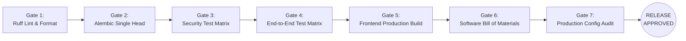

# Legal Case Companion — Release Engineering & Versioning Standard

**Document Reference**: LCC-DOC-025  
**Classification**: Engineering Governance  
**Current Release**: `1.0.0` (`prod-2026.09.04`)

---

## 1. Branching Strategy & Git Workflow

Legal Case Companion adheres to a Trunk-Based Release Model with strict verification gates:

```
[feature/lcc-xxx] ----\
                       \ (PR + Automated CI + Code Review)
                        v
[main (protected)] ============================================>
                                \
                                 \ (Release Tag: v1.0.0)
                                  v
                       [Deployment Pipeline]
```

1. **Main Branch Protection**:
   - Direct pushes to `main` are strictly blocked.
   - Merging requires passing all GitHub Actions checks (linting, linear migration head, backend integration, security, e2e, frontend build).
   - Minimum 1 approved code review from an authorized security engineer.
2. **Release Tagging**:
   - Every production release is tagged with an annotated Git tag: `git tag -a v1.0.0 -m "Release v1.0.0"`.
   - The tag MUST match `APP_VERSION` in `app/core/config.py`.

---

## 2. Release Identification & Traceability

Every running artifact in the cluster exposes its exact provenance:
- **`APP_VERSION`**: Semantic version (`MAJOR.MINOR.PATCH`).
- **`RELEASE_ID`**: Operational release identifier combining environment and ISO date (`prod-YYYY.MM.DD`).
- **Health Exposure**: `/api/v1/health/details` reports `version` and `release_id` without exposing secrets or internals.

---

## 3. Mandatory Pre-Release Quality Gates

A release is considered **UNAPPROVED** and **BLOCKED** from deployment until all 7 gates pass:



| Gate # | Scope | Command | Acceptance Criteria |
| :--- | :--- | :--- | :--- |
| **1** | Python Code Quality | `ruff check .` | 0 errors, 0 warnings |
| **2** | Migration Linearity | `alembic heads` | Exactly 1 revision output |
| **3** | Security Hardening Suite | `pytest tests/security/ -v` | 100% passing (18/18 tests) |
| **4** | Full E2E & Pilot Matrix | `pytest tests/e2e/ -v` | 100% passing (40/40 tests) |
| **5** | Frontend Production Build | `npm run build` (in `frontend/`) | 0 TypeScript errors, 25 static/SSG routes |
| **6** | Dependency Vulnerability & SBOM | `npm audit` & `python scripts/generate_sbom.py` | 0 high/critical CVEs; valid CycloneDX SBOMs |
| **7** | Configuration Diagnostics | `python scripts/verify_production_config.py --env production` | Exit Code 0 |

---

## 4. Software Bill of Materials (SBOM) Management

In compliance with Executive Order 14028 and ISO/IEC 5230 software supply chain standards:
1. Every release compiles CycloneDX 1.5 JSON manifests:
   - `sbom-backend.json`: Comprehensive PyPI dependencies, versions, and licenses.
   - `sbom-frontend.json`: Complete npm node_modules inventory.
2. Manifests are archived with release build logs in the private artifacts repository.

---

## 5. Post-Release Observation Window

Following traffic switch to a new release:
1. **0-15 Minutes**: Continuous monitor of HTTP 5xx rates, Redis latency, and worker claim loops.
2. **15-60 Minutes**: Verify async workers, email delivery rates, video session creation rates.
3. If error rate exceeds **0.1%** or any data integrity issue is observed, immediate rollback is initiated.
