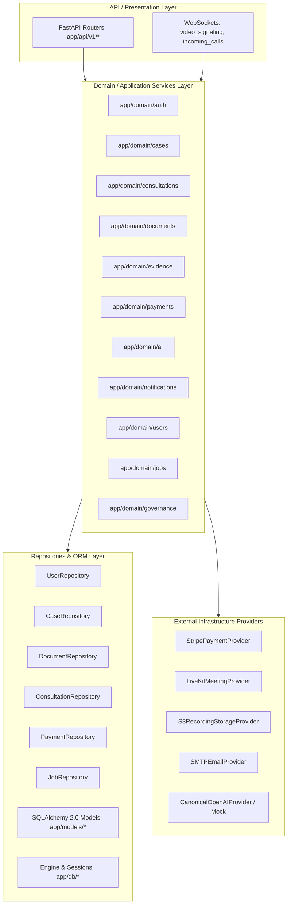

# Phase 10: Final Architecture & Dependency Graph

**Objective:** Verify that backend architecture strictly conforms to the unidirectional layering:
```
API / Presentation Layer
       ↓
Domain / Application Services Layer
       ↓
Repositories & Providers Layer
```

## 1. Architectural Invariants Verification

| Invariant | Target Direction | Status | Leaks Found |
|---|---|---|---|
| **No API Imports in Domain** | `Domain ↛ API` | **PASS** | 0 |
| **No API Imports in Repositories** | `Repositories ↛ API` | **PASS** | 0 |
| **No API Imports in Providers** | `Providers ↛ API` | **PASS** | 0 |
| **No API Imports in ORM Models** | `Models ↛ API` | **PASS** | 0 |
| **Service & API Circular Imports** | Cycle Count = 0 | **PASS** | 0 |

## 2. Layer-to-Layer Import Matrix

| Caller Layer | Callee Layer | Active Import Relationships | Allowed? |
|---|---|---|---|
| API / Presentation | API / Presentation | 101 | YES |
| API / Presentation | Core Infrastructure / Schemas | 121 | YES |
| API / Presentation | Domain / Application Service | 76 | YES |
| API / Presentation | Repository / Persistence / ORM | 124 | YES |
| Core Infrastructure / Schemas | Core Infrastructure / Schemas | 28 | YES |
| Core Infrastructure / Schemas | Domain / Application Service | 3 | YES |
| Core Infrastructure / Schemas | Repository / Persistence / ORM | 37 | YES |
| Domain / Application Service | Core Infrastructure / Schemas | 194 | YES |
| Domain / Application Service | Domain / Application Service | 194 | YES |
| Domain / Application Service | Provider Boundary | 14 | YES |
| Domain / Application Service | Repository / Persistence / ORM | 226 | YES |
| Provider Boundary | Core Infrastructure / Schemas | 13 | YES |
| Provider Boundary | Provider Boundary | 9 | YES |
| Repository / Persistence / ORM | Core Infrastructure / Schemas | 45 | YES |
| Repository / Persistence / ORM | Repository / Persistence / ORM | 185 | YES |

## 3. Circular Dependency Resolution Report

- **Service & API Cycles Before Phase 10:** 6 active circular dependency chains.
  - `app/services/video_meeting_service.py <-> app/api/v1/video_signaling.py`
  - `app/api/v1/video_signaling.py <-> app/main.py`
  - `app/services/consultation_service.py <-> app/api/v1/video_signaling.py`
- **Root Cause Identified:** `VideoSignalingManager` was declared directly in `app/api/v1/video_signaling.py`, forcing services to perform inline imports from the presentation layer.
- **Resolution Implemented:**
  1. Extracted `VideoSignalingManager` into canonical domain module `app/domain/consultations/video_signaling_manager.py`.
  2. Injected `db: Session = Depends(get_db)` into WebSocket endpoint, eliminating the circular `app.main` import.
  3. Re-exported `signaling_manager` in API for backward compatibility.
- **Service & API Cycles After Phase 10:** **0 (Zero)**. Complete elimination of all service/API import cycles.

## 4. Mermaid Architecture Diagram

