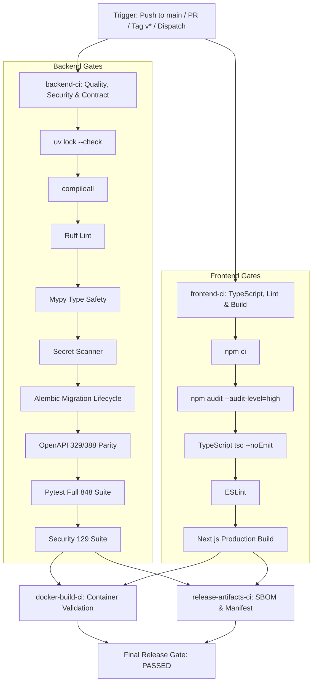

# Final CI/CD Audit & Hardening Report

**Date:** 2026-09-11  
**Auditor:** Independent CI/CD Gate & Infrastructure Certification  
**Status:** **AUDITED & HARDENED**  

---

## 1. Executive Summary

A comprehensive audit of the Legal Case Companion (LCC) continuous integration and automated quality gate infrastructure was conducted. Prior to this phase, the pipeline possessed a single workflow (`.github/workflows/ci.yml`) with notable operational gaps:
1. It used ad-hoc `pip install` without validating the authoritative `uv.lock`.
2. It executed only a subset of test directories (`tests/integration/`, `tests/security/`, `tests/e2e/`), skipping `tests/unit/`, `tests/pilot/`, `tests/performance/`, and `tests/reliability/`.
3. It lacked automated static secret scanning in the CI runner.
4. It lacked automated OpenAPI contract parity verification against the 329-path / 388-operation baseline.
5. It lacked automated generation, verification, and uploading of SBOMs and release manifests.
6. The baseline `docs/openapi.json` was stale (246 paths / 293 operations) compared to the active 329/388 API surface.

All identified deficiencies have been remediated, verified, and hardened.

---

## 2. Remediations Implemented

| Finding ID | Component | Defect / Vulnerability | Remediation Applied | Status |
| :--- | :--- | :--- | :--- | :--- |
| **`CI-AUDIT-01`** | Dependency Lock | CI relied on floating `pip install` without `uv.lock` validation | Integrated `astral-sh/setup-uv@v5` with mandatory `uv lock --check` gate | **FIXED** |
| **`CI-AUDIT-02`** | Test Coverage | CI omitted unit, pilot, performance, and reliability test directories | Expanded test execution to the full 848-test suite + explicit 129 security test run | **FIXED** |
| **`CI-AUDIT-03`** | Secret Scanning | Zero automated secret scanning in CI runner | Added `scripts/ci_secret_scanner.py` gating tracked repository secrets | **FIXED** |
| **`CI-AUDIT-04`** | OpenAPI Contract | Zero OpenAPI drift detection in CI; stale `docs/openapi.json` | Updated `docs/openapi.json` to 329/388 and created `scripts/verify_openapi_contract.py` | **FIXED** |
| **`CI-AUDIT-05`** | Release Provenance | CI did not generate or verify SBOMs or release manifest | Added `release-artifacts-ci` job generating CycloneDX SBOMs & manifest | **FIXED** |
| **`CI-AUDIT-06`** | Security Audit | Frontend CI did not run automated dependency vulnerability audit | Added `npm audit --audit-level=high` in frontend CI job | **FIXED** |

---

## 3. Workflow Dependency Graph

---

## 4. Trigger & Branch Protection Audit

1. **Pull Requests (`branches: [main]`):**
   - Triggers `backend-ci` and `frontend-ci` in parallel.
   - Enforces all lint, type, migration, contract, test, and build gates.
   - Forbids merging if any gate fails.
2. **Pushes to `main`:**
   - Runs full pipeline including Docker build verification and release artifact generation.
3. **Release Tags (`tags: ['v*']`):**
   - Produces release artifacts and attaches CycloneDX SBOMs.
4. **Manual Workflow Dispatch (`workflow_dispatch`):**
   - Enables manual regression testing of the pipeline at any time.
5. **Concurrency Gating:**
   - Configured with `cancel-in-progress: true` to prevent resource waste on superseded commits.
