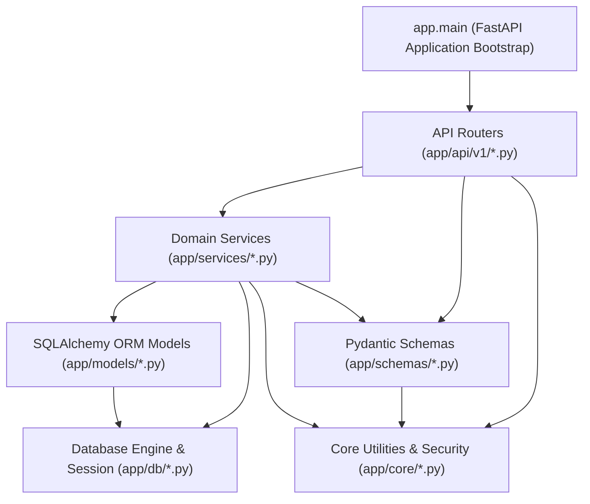
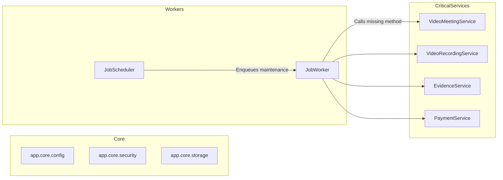

# Dependency & Reference Graph Analysis: Legal Case Companion (LCC)

**Auditor**: Antigravity Engineering  
**Scope**: Complete static AST & symbol reference analysis for Python (`app/`, `tests/`, `scripts/`) and TypeScript/JavaScript (`frontend/`)

---

## 1. Architectural Layer Hierarchy & Dependency Flow

The LCC backend follows a strict unidirectional layered architecture:



### Layer Rules:
1. **Models** must never import from Services, Schemas, or API Routers.
2. **Core** must remain agnostic of domain entities (zero imports from `models/` or `services/`).
3. **Services** encapsulate all database queries, mutations, and domain validation.
4. **API Routers** handle HTTP serialization, status codes, query parsing, and role authorization via `deps.py`.

---

## 2. Python Dependency & Reference Analysis

### 2.1 Files Imported Nowhere in Application Source (`app/`)
The following 8 files in `app/` have **zero incoming imports** from any file within `app/`:

| File Path | Importers in `app/` | Importers in `tests/` | Importers in `scripts/` | Classification | Risk & Status |
| :--- | :---: | :---: | :---: | :--- | :--- |
| `app/db/session.py` | **0** | **0** | **0** | **Dead Legacy Re-export Alias** | **SAFE TO DELETE** (after removing any external references) |
| `app/services/abuse_defense_service.py` | **0** | 1 | 0 | **Dead / Unhooked Service** | **KEEP & HOOK UP** (Intended for Phase XX abuse defense) |
| `app/services/ai_budget_service.py` | **0** | 1 | 0 | **Dead / Unhooked Service** | **KEEP & HOOK UP** (Intended for token quotas) |
| `app/services/cancellation_policy_service.py` | **0** | 1 | 0 | **Dead / Unhooked Service** | **KEEP & HOOK UP** (Commercial refund engine) |
| `app/services/lifecycle_service.py` | **0** | 1 | 0 | **Dead / Unhooked Service** | **KEEP & HOOK UP** (Account status transition rules) |
| `app/services/reminder_service.py` | **0** | 3 | 0 | **Dead / Unhooked Service** | **KEEP & HOOK UP** (Operational notifications) |
| `app/scheduler.py` | **0** | 1 | 0 | **Production CLI Entrypoint** | **KEEP** (Executed via `python -m app.scheduler` in `render.yaml`) |
| `app/worker.py` | **0** | 1 | 0 | **Production CLI Entrypoint** | **KEEP** (Executed via `python -m app.worker` in `render.yaml`) |

---

### 2.2 Deep Dive: Dead & Unhooked Backend Services

#### 1. `app/db/session.py` (Pure Dead File)
- **Contents**:
  ```python
  from app.db.database import SessionLocal, engine, get_db
  __all__ = ["SessionLocal", "engine", "get_db"]
  ```
- **Analysis**: Legacy shim created during early development. The entire codebase standardly imports from `app.db.database` directly (e.g. `from app.db.database import get_db`). No test, script, or application file references `app.db.session`.
- **Recommendation**: Mark for candidate removal in Phase 2.

#### 2. `app/services/abuse_defense_service.py`
- **Purpose**: Provides `check_registration_risk` and `check_consultation_velocity`.
- **Current State**: Implemented with unit tests in `tests/public_readiness/test_phase_xx_public_launch_readiness.py`, but neither `app/api/v1/auth.py` nor `app/api/v1/consultations.py` imports or invokes it.
- **Architectural Risk**: High. The platform is vulnerable to automated registration of disposable emails and consultation spamming because this protective service is bypassed.
- **Action**: Wire into registration and consultation booking endpoints during the Service Integration phase.

#### 3. `app/services/ai_budget_service.py`
- **Purpose**: Enforces daily token and query quotas on AI research queries (`check_and_consume_budget`).
- **Current State**: Implemented and tested in `tests/evaluation/test_ai_cost_and_budget_governance.py`, but `app/api/v1/ai.py` and `assistant.py` execute OpenAI queries without consulting this governor.
- **Action**: Integrate into `AIService` query pipelines.

#### 4. `app/services/cancellation_policy_service.py`
- **Purpose**: Computes deterministic refund percentages (100% advance, tiered late cancellation, 0% client no-show).
- **Current State**: Implemented and tested in `tests/unit/test_refund_reliability.py`. Not called by `consultations.py` cancel handler.
- **Action**: Integrate into consultation cancellation lifecycle.

#### 5. `app/services/reminder_service.py`
- **Purpose**: Periodic scanner that identifies hearings listed in 24h, deadlines approaching in 48h, and consultations in 2h, generating deduplicated notifications.
- **Current State**: Tested in `tests/unit/test_background_maintenance_jobs.py`, but not enqueued by `job_scheduler.py` or executed by `job_worker.py`. Also contains 5 typing bugs against `Consultation` attributes.
- **Action**: Fix model attribute mappings and register in `JobScheduler.trigger_periodic_scans`.

---

### 2.3 Broken Method Call Reference: `cleanup_stale_meetings`
- **Call Sites**:
  - `app/services/job_worker.py:504`:
    ```python
    service = VideoMeetingService(self.db)
    cleaned_count = service.cleanup_stale_meetings(max_idle_hours=max_idle_hours)
    ```
  - `tests/integration/test_video_session_reliability.py:240`:
    ```python
    service = VideoMeetingService(db)
    cleaned_count = service.cleanup_stale_meetings(max_idle_hours=2)
    ```
- **Target**: `VideoMeetingService` in `app/services/video_meeting_service.py`.
- **Defect**: The method `cleanup_stale_meetings` does not exist on `VideoMeetingService`.
- **Runtime Impact**: The `STALE_MEETING_CLEANUP` background job crashes with `AttributeError` and goes into continuous retry, leaking database connections and leaving stale meetings in `ACTIVE` state indefinitely.

---

## 3. Frontend Dependency & Reference Analysis

### 3.1 Non-Entry Files with Zero Incoming References
Next.js App Router relies on conventional entry points (`page.tsx`, `layout.tsx`, `route.ts`). Files outside these conventions that have **zero incoming imports** represent candidate dead code or standalone test utilities:

| File Path | Functional Purpose | Status / Risk | Recommendation |
| :--- | :--- | :--- | :--- |
| `frontend/src/components/ActionCenter/ActionCenter.tsx` | Unused action center widget | Dead UI Component | **KEEP / MERGE** into dashboard |
| `frontend/src/components/Collaboration/MatterBriefCard.tsx` | Matter summary card | Dead UI Component | **KEEP / MERGE** into matter view |
| `frontend/src/components/Collaboration/MatterParticipantsPanel.tsx` | Participant list side-panel | Dead UI Component | **KEEP / MERGE** into matter view |
| `frontend/src/components/Collaboration/MatterRequestsBoard.tsx` | Document requests kanban | Dead UI Component | **KEEP / MERGE** into matter view |
| `frontend/src/components/Intelligence/IntelligenceCenter.tsx` | Case AI intelligence hub | Dead UI Component | **KEEP / MERGE** into case detail |
| `frontend/capture_case_detail_and_copilot.mjs` | Puppeteer screenshot script | Standalone Root Script | **MOVE** to `scripts/e2e/` |
| `frontend/capture_redesign_screenshots.mjs` | Puppeteer UI screenshot script | Standalone Root Script | **MOVE** to `scripts/e2e/` |
| `frontend/test_browser_flow.mjs` | Puppeteer browser validation | Standalone Root Script | **MOVE** to `scripts/e2e/` |
| `frontend/test_phase_7_1_qa.mjs` | Puppeteer QA flow | Standalone Root Script | **MOVE** to `scripts/e2e/` |
| `frontend/test_video_flow.mjs` | Puppeteer WebRTC room tester | Standalone Root Script | **MOVE** to `scripts/e2e/` |
| `frontend/patch-fs.js` | Legacy Node.js fs monkey-patch | Build Hook Script | **EVALUATE** for safe removal |

---

## 4. Inter-Module Coupling & Architectural Risks



1. **Job Worker / Video Meeting Coupling**:
   - `job_worker.py` dynamically imports `VideoMeetingService` inside its handler. Static analysis does not catch missing methods until runtime or type checking.
2. **Dual Video Signaling / Room Management**:
   - `video_signaling.py` handles real-time WebSocket state, while `video_meeting_service.py` manages database records and tokens. Coordination relies on room ID string matching.
3. **Storage Abstraction Consistency**:
   - `app/core/storage.py` provides general object storage (`get_storage_provider()`), while `app/services/recording_storage.py` provides specialized video recording chunk storage (`get_recording_storage_provider()`). These duplicate S3 bucket configuration and signing keys.
