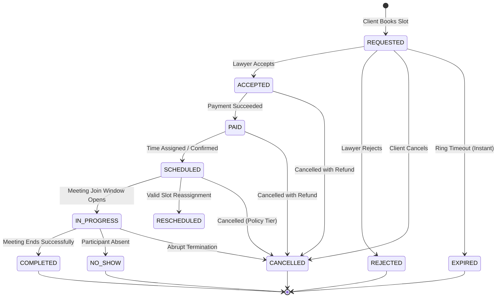
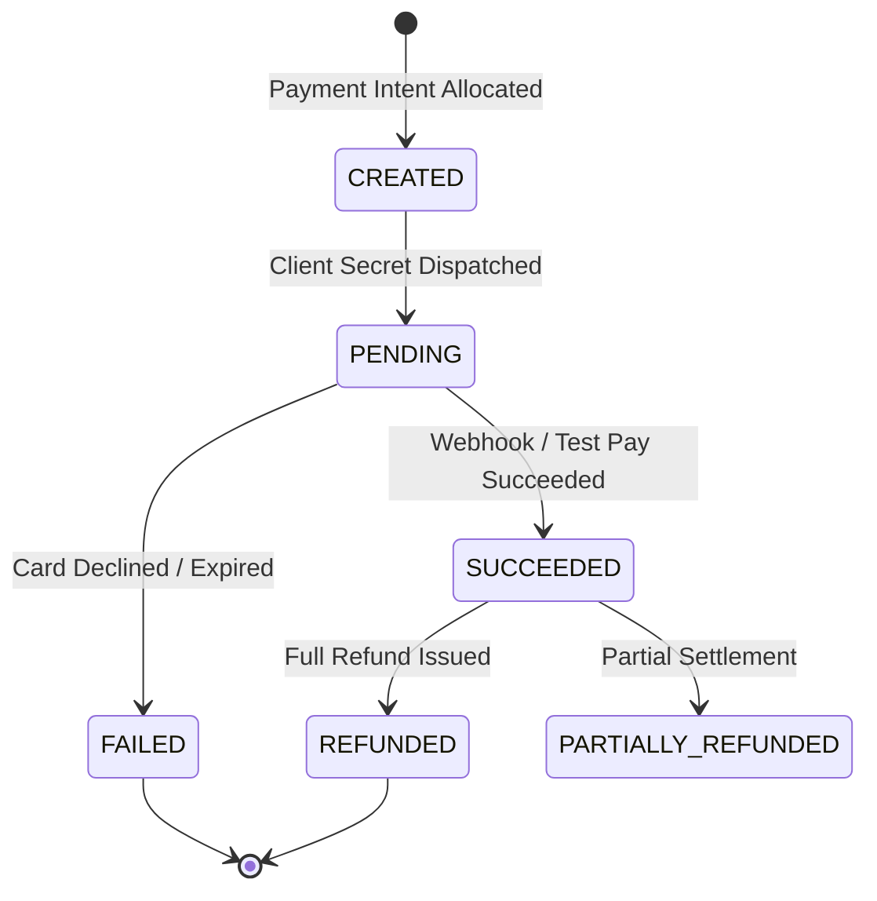
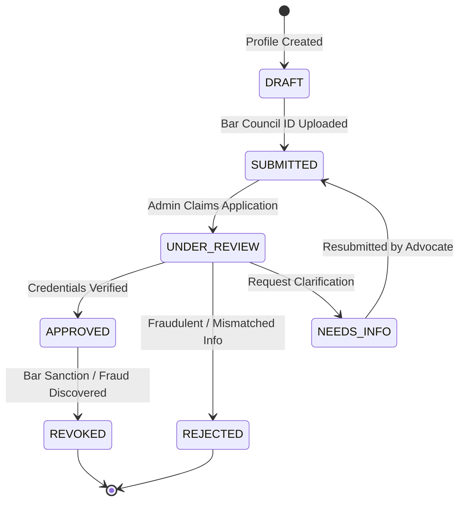
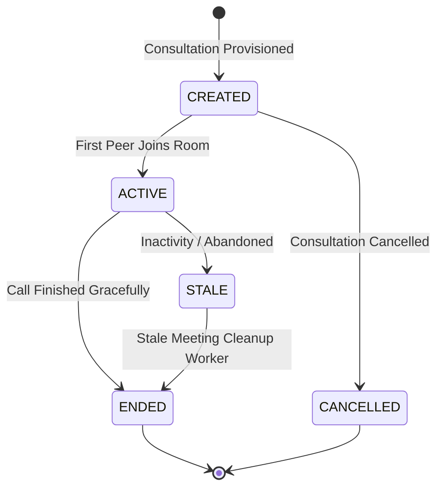
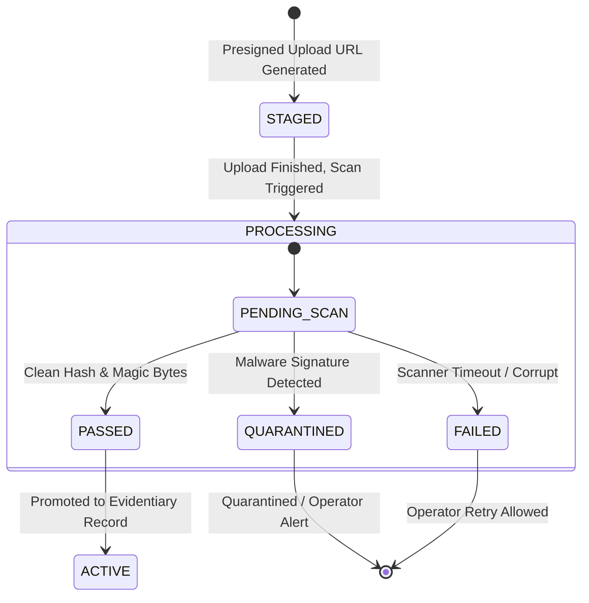

# Phase 9: State Machine Reliability Audit

## 1. Overview & Invariants

In the Legal Case Companion (LCC) application, domain entities transition through rigorous state machines. State machine integrity is critical because legal, financial, and procedural rights depend on state validity (e.g. an advocate cannot be paid for an uncompleted consultation; a closed case cannot accept evidentiary filings; a cancelled meeting cannot be joined).

Core Invariants Enforced:
1. **Forward Progression**: Terminal states are strictly irreversible.
2. **Atomic Transitions**: Every transition occurs within a row-locked database transaction (`with_for_update`).
3. **Idempotency**: Re-applying a transition that matches the current state returns success without re-executing side effects.
4. **Illegal Jump Defense**: Unauthorized or out-of-order jumps raise explicit HTTP 400/422 validation errors.

---

## 2. Master State Machine Audits

### 2.1 Consultation State Machine (`ConsultationStatus`)

#### Legal Transitions
- `REQUESTED` → `ACCEPTED`, `REJECTED`, `CANCELLED`, `EXPIRED`
- `ACCEPTED` → `PAID`, `CANCELLED`
- `PAID` → `SCHEDULED`, `CANCELLED`
- `SCHEDULED` → `IN_PROGRESS`, `SCHEDULED` (Reschedule), `CANCELLED`
- `IN_PROGRESS` → `COMPLETED`, `NO_SHOW`, `CANCELLED`

#### Terminal States (Strictly Irreversible)
- `COMPLETED`, `CANCELLED`, `REJECTED`, `NO_SHOW`, `EXPIRED`

#### Illegal Transitions Audited & Blocked
- `COMPLETED` → `REQUESTED` (422: Cannot re-open completed consultation)
- `COMPLETED` → `SCHEDULED` (422: Cannot reschedule completed meeting)
- `CANCELLED` → `IN_PROGRESS` (404/422: Room access status denied)
- `REJECTED` → `PAID` (422: Cannot create payment intent for rejected booking)

---

### 2.2 Commercial Payment State Machine (`PaymentStatus`)

#### Legal Transitions
- `CREATED` → `PENDING`
- `PENDING` → `SUCCEEDED`, `FAILED`
- `SUCCEEDED` → `REFUNDED`, `PARTIALLY_REFUNDED`

#### Out-of-Order Webhook Protection
- If a `payment_intent.payment_failed` webhook arrives *after* a `payment_intent.succeeded` webhook was already processed, the state machine **refuses to downgrade** the status to `FAILED`. Terminal success remains authoritative.

#### Illegal Transitions Audited & Blocked
- `REFUNDED` → `REFUNDED` (422: Double refund blocked; cumulative refund capped at original payment amount)
- `FAILED` → `REFUNDED` (422: Cannot refund an uncaptured payment)
- `CREATED` → `REFUNDED` (422: Cannot refund un-captured intent)

---

### 2.3 Advocate Bar Verification State Machine (`VerificationStatus`)

#### Legal Transitions
- `DRAFT` → `SUBMITTED`
- `SUBMITTED` → `UNDER_REVIEW`
- `UNDER_REVIEW` → `APPROVED`, `REJECTED`, `NEEDS_INFO`
- `NEEDS_INFO` → `SUBMITTED`
- `APPROVED` → `REVOKED`

#### Protection Against Self-Approval
- Only users with `UserRole.ADMIN` can execute transitions out of `UNDER_REVIEW`. Advocates cannot approve their own verification under any circumstance.

---

### 2.4 Video Meeting State Machine (`VideoMeetingStatus`)

#### Automated Lifecycle Cleanup
- `stale_meeting_cleanup_job`: Evaluates rooms in `ACTIVE` state where no heartbeat has been received for >15 minutes. Automatically flips status to `ENDED` and releases LiveKit/internal room resources.

---

### 2.5 Evidence & Document Processing State Machine (`EvidenceStatus` & `ScanStatus`)

#### Fail-Closed Security Invariant
- Evidence files remain strictly inaccessible (`EvidenceStatus.STAGED`) until `ScanStatus.PASSED` is verified.
- If the scanner times out or fails, the file fails closed (`FAILED`), preventing unverified bytes from entering case bundles.

---

## 3. Test Coverage & Verification

All state machine invariants and illegal transition defenses are actively validated in:
- `tests/integration/test_phase_9_cross_system_reliability.py` (`test_state_machine_illegal_transition_rejection`, `test_payment_intent_reuse_and_webhook_idempotency`)
- `tests/unit/test_refund_reliability.py` (`test_cumulative_partial_refunds_and_cap_enforcement`)
- `tests/unit/test_video_meeting_cleanup.py` (`test_cleanup_stale_meetings_already_closed`)
- `tests/integration/test_phase_8_frontend_contracts.py` (`test_case_status_enums_contract`)
